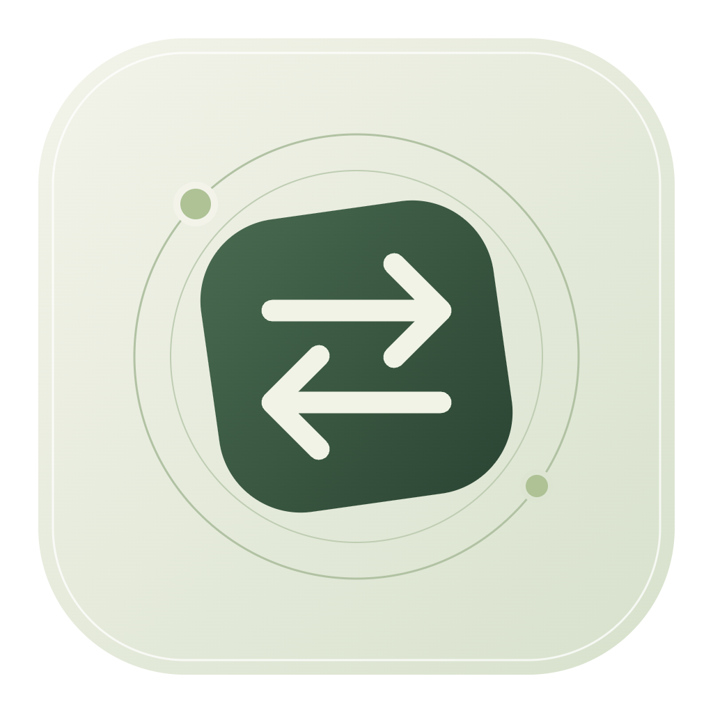
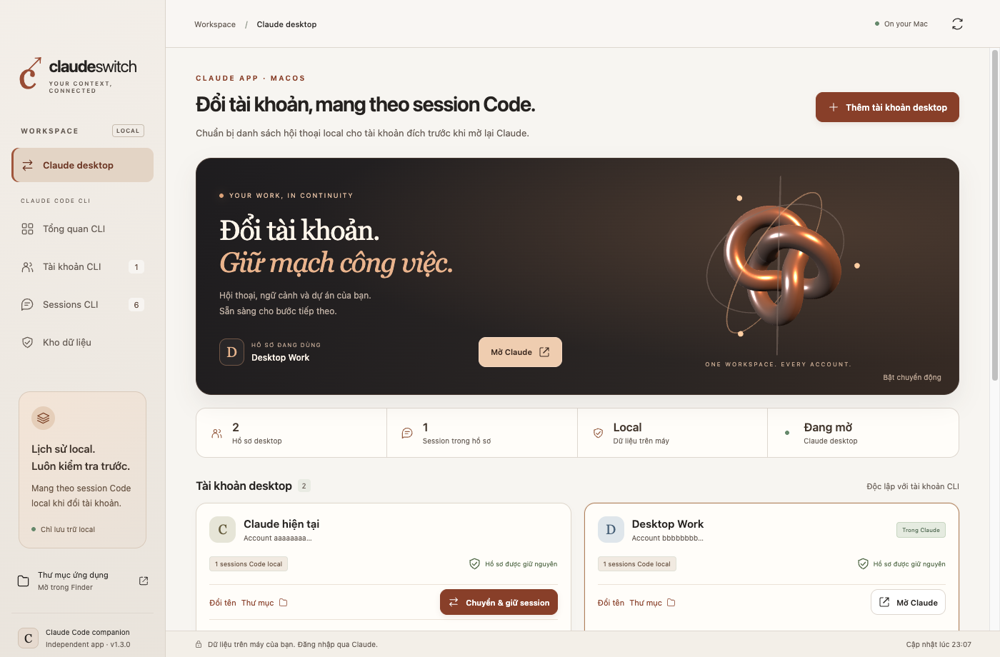

<div align="center">
  
  <h1>Claude Switch</h1>
  <p><strong>Switch accounts. Keep your flow.</strong></p>
  <p>A local macOS companion for Claude desktop profiles and Claude Code conversations.<br>Built with Electron, Three.js, and a small native Swift bridge. Vietnamese interface.</p>
  <p><a href="https://github.com/DuongVuIT/claude-switch/releases">Download for Apple Silicon</a> · <a href="#quick-start">Quick start</a> · <a href="#development">Build from source</a> · <a href="docs/TESTING.md">Testing</a></p>
</div>



> Independent community project. Not affiliated with or endorsed by Anthropic. Desktop session transfer uses Claude's local storage format, not an official account migration API. Start with a separate backup.

## What it does

Claude desktop indexes local Code sessions by account and organization. Changing accounts can hide sessions from the sidebar even when their transcripts still exist on disk. Claude Switch can prepare those local session entries for another saved desktop profile while retaining the original transcript IDs.

- **Desktop profiles:** keep each profile's user-data directory and switch through a graceful Claude restart.
- **Local Code continuity:** validate transcripts, back up source metadata, and add missing session entries to the destination organization. Existing destination entries are not overwritten.
- **Claude Code CLI profiles:** separate login configurations, share local history, search conversations, preview messages, and resume in Terminal or copy a command for an IDE terminal.
- **Local backups:** create CLI snapshots with SHA-256 manifests and warnings for files that change during copying.
- **Three.js interface:** a copper-toned 3D centerpiece, responsive layout, pause control, reduced-motion support, and a static fallback when WebGL is unavailable. Assets are bundled locally; no CDN is required.

## Scope and limits

| Data or behavior | Support |
| --- | --- |
| Local Code session entries and existing JSONL transcripts | Prepared for the selected saved desktop profile; original transcript IDs retained |
| Existing destination session entries | Kept as-is, including their titles/activity metadata |
| Desktop login and application storage | Preserved separately by rotating whole profile directories on the same machine |
| Project files and external attachments | Stay at their existing paths; they are not a portable project export |
| Scratch workspaces and side-session notes | Copied into the destination without replacing existing files |
| Chat, Cowork and cloud-only history | **Not migrated between accounts** |
| Subscription, usage limits, organization access and SSO | **Not transferred or bypassed** |
| Source desktop connector settings, tool grants and schedules | **Not copied into transferred session metadata**; destination settings and project configuration still apply |
| Switching a running task without interruption | **Not supported**; stop tasks before switching |
| Brand-new desktop profile while current profile has history | **Setup limitation:** switching is blocked until the destination has a saved login and organization; there is no guided onboarding/import flow yet |
| Automatic full restore from backup / cross-machine account migration | **Not supported** |

This is an experimental local integration. A future Claude update may change its storage format. A single successful session does not guarantee all tools, attachments, organizations or models work with another account.

## Quick start

### Install on macOS

1. Install the official Claude desktop app. For CLI features, install Claude Code separately.
2. Download `Claude-Switch-1.3.0-mac-arm64.zip` from [Releases](https://github.com/DuongVuIT/claude-switch/releases).
3. Extract it and drag **Claude Switch.app** to **Applications**.
4. Open the app. The release is not signed with Apple Developer ID or notarized; macOS may require approval in **System Settings → Privacy & Security**. Do not disable Gatekeeper globally.

Prebuilt releases target **Apple Silicon**. Intel macOS, Windows and Linux are not validated. Downloading the application on another machine does not restore your accounts or conversations.

### Switch an existing desktop profile

1. Stop active Code/Cowork tasks and make a separate backup of important work.
2. On **Claude desktop**, select a saved, logged-in profile and click **Chuyển & giữ session**.
3. Choose the destination organization. IDs are displayed because organization names are not resolved through a private API.
4. Click **Đóng Claude & chuyển**. The app validates the local transcripts, requests a normal quit, waits for workers, backs up metadata and prepares missing entries before rotating profiles.
5. In the reopened Claude app, open the **Code** tab and select your old session. Check the active account and permissions before continuing.

**First-time setup:** the current desktop installation is registered as **Claude hiện tại**. **Thêm tài khoản desktop** creates an empty profile, not an authenticated account. If the current profile has no local Code sessions, you can open that empty profile and log in through Claude, then open Code and refresh Claude Switch. If history already exists, the continuity guard blocks switching to an uninitialized profile. Do not remove your history to bypass this guard. This version is most useful when both profiles are already prepared.

### Use CLI accounts

1. Open **Tài khoản CLI**, add a named profile, then click **Đăng nhập**. Complete Claude's official login in Terminal/browser.
2. Refresh to verify authentication. Click **Chọn** to select the profile for subsequent launches.
3. Open **Sessions CLI**, search and preview a conversation. Click **Tiếp tục trong Terminal**, or copy the resume command into an IDE terminal.
4. Use **Kho dữ liệu** to create a CLI snapshot and reveal its manifest in Finder.

CLI selection does not change an already-running terminal process or the account used by a graphical IDE extension. Stop an existing process before resuming the same transcript elsewhere. User-level CLI extensions/configuration may be shared, and project-level authentication is checked before a launch.

## How your data is handled

No application server, telemetry, third-party analytics or remotely loaded UI assets are included. The renderer has no Node.js access, a restrictive CSP and a whitelisted preload API. Claude itself still connects to Anthropic for authentication and model requests.

| Location | Purpose |
| --- | --- |
| `~/Library/Application Support/Claude` | Active official Claude desktop user data |
| `~/Library/Application Support/Claude Switch/desktop-profiles` | Inactive desktop profiles |
| `~/Library/Application Support/Claude Switch/backups` | CLI snapshots and desktop transfer metadata backups |
| `~/.claude/projects` | Shared local Code transcripts |
| `~/.claude.json` | Global CLI configuration included in CLI snapshots |

Desktop switching preserves complete profile directories, including sensitive local application storage, without decrypting cookies or reading macOS Keychain. Backend code reads configuration for known account fields; token/password fields are not sent to the renderer. Transferred desktop session metadata uses an allowlist and resets the permission mode. CLI profile setup has a different policy: it can reuse user-level MCP definitions, extensions and shared configuration, which may themselves contain secrets.

Backups are **not fully encrypted**. CLI snapshots contain regular files from `~/.claude`, global configuration, and app-managed CLI profiles; symlinks are recorded rather than followed. They do **not** snapshot the entire desktop profile, macOS Keychain or external repositories. Desktop transfer backups retain source session metadata, not a complete machine backup. Rotated desktop profiles are live storage, not independent snapshots. Use Time Machine or another separate backup for complete recovery.

Never upload real profile folders, snapshots, `.claude.json`, cookies, tokens or conversation JSONL files to GitHub. The repository and release ZIP contain application code/assets only. See [SECURITY.md](SECURITY.md).

## Troubleshooting

| Symptom | What to do |
| --- | --- |
| Destination switch button disabled | Prepare an authenticated destination with a known Code organization; see the first-time setup limitation above |
| Missing transcript or conflicting session ID | Switching stops; restore the correct transcript or investigate the conflict. Existing destination entries are not replaced |
| Session opens but the project is missing | Restore the original project path; history alone does not recreate project files |
| Claude workers have not exited | Finish tasks, close Claude normally and retry; the app does not force-kill workers |
| Interrupted profile rotation | Use **Khôi phục lần chuyển**. The journal checks directory identities and refuses ambiguous recovery |
| Login expired / model unavailable | Reauthenticate in Claude or select a model supported by the destination account |
| 3D effect is unavailable | Account controls still work with static artwork; use the pause control or macOS Reduce Motion |

Do not manually merge Chromium databases or edit tokens to fix login problems.

## Development

Requires macOS, Node.js (tested with 24), npm and Xcode Command Line Tools for the native bridge.

```sh
git clone https://github.com/DuongVuIT/claude-switch.git
cd claude-switch
npm ci
npm run build:native
npm start
```

```sh
npm test              # isolated core / transfer / recovery tests
npm run test:ui       # Electron fixture UI; does not switch real Claude
npm run package      # Apple Silicon bundle in release/
```

The packaged app is `release/Claude Switch-darwin-arm64/Claude Switch.app`. The launcher `Open Claude Switch.command` opens that bundle after packaging. `npm run package` requires the native bridge to have been built first.

```text
electron/   IPC, CLI profiles, backups, desktop rotation and session transfer
native/     Swift bridge for official Claude status / graceful quit / open
src/        Local HTML/CSS/JS interface and Three.js scene
assets/     App icons
tests/      Isolated tests and explicitly manual live checks
docs/       Test scope and screenshots containing sample data only
```

See [testing notes](docs/TESTING.md) for verification boundaries. Live scripts are opt-in; do not run them against your main profile without reading them first.

## Contributing

Bug reports and focused PRs are welcome. Include macOS architecture, Claude desktop version, Claude Switch version, steps to reproduce and a redacted error. Use synthetic transcripts for tests. Do not attach authentication data or real conversations. See [CONTRIBUTING.md](CONTRIBUTING.md).

Useful contributions: first-time desktop onboarding, compatibility across Claude versions, accessibility, translations and distribution signing. No bypasses for account permissions or service limits.

## License

[MIT](LICENSE) © 2026 DuongVuIT. Third-party dependencies retain their respective licenses. Claude is a product of Anthropic; this project's name does not imply affiliation.
